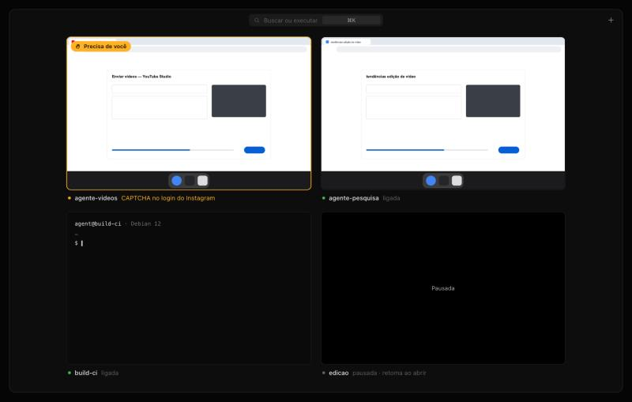

<div align="center">

# HyzeVM

**Um computador Linux só para cada agente de IA.**

Suba uma máquina Debian limpa em ~10 segundos. Seu agente roda código, navega, envia arquivos e posta conteúdo —
você assiste à tela e assume quando ele travar.

[English](README.md)



</div>

> **Status: alfa.** Feito e testado em **macOS (Apple Silicon)**. Linux e Windows estão implementados, mas ainda não testados.

## Instalação

Precisa do [QEMU](https://www.qemu.org/) e do cliente OpenSSH:

```bash
brew install qemu                     # macOS
sudo apt install qemu-system qemu-utils qemu-efi-aarch64 openssh-client   # Debian/Ubuntu
winget install --id SoftwareFreedomConservancy.QEMU -e                            # Windows
cargo install --git https://github.com/Hamertingo/hyzevm hyzevm
hyzevm doctor
```

## Uso rápido

```bash
hyzevm create trabalho                           # Debian 12 em ~10 s
hyzevm exec trabalho -- 'uname -a'
hyzevm create web --template desktop --always-on # com tela e navegador, 24 h
hyzevm view web                                  # assistir no navegador
hyzevm browser snapshot web                      # a página como lista de elementos
```

## Para agentes

```json
{ "mcpServers": { "hyzevm": { "command": "hyzevm", "args": ["mcp"] } } }
```

```bash
hyzevm skill install     # ensina o agente a usar o hyzevm
```

Quando o agente encontra CAPTCHA ou 2FA ele chama `takeover request`: você recebe uma notificação, assume a tela
e devolve. Ele **não** tenta contornar a verificação.

## App

Grade com todas as máquinas ao vivo, foco numa delas, assumir/devolver o controle, paleta `⌘K`, menu de botão
direito e painel `⌘I`. Gere com `./scripts/bundle-macos.sh`.

## Licença

[MIT](LICENSE)

## Agent control & safety / Controle e segurança

```sh
hyzevm ask send web "Post it?" --options yes,no --wait 600   # the agent asks, you answer in the app
hyzevm guard set web --require publish,delete,pay,upload     # the agent must get your OK first (approve)
hyzevm activity web                                          # everything it did, with timestamps
hyzevm record auto web on --keep 3d                          # optional screen recording, 3-day retention
hyzevm checkpoint save web before-bulk-upload                # live restore point; checkpoint restore to go back
hyzevm net set web --allow instagram.com,facebook.com        # outbound allow-list (applies on next boot)
hyzevm clone web web-2 · hyzevm summary · hyzevm notify set <topic>
```
